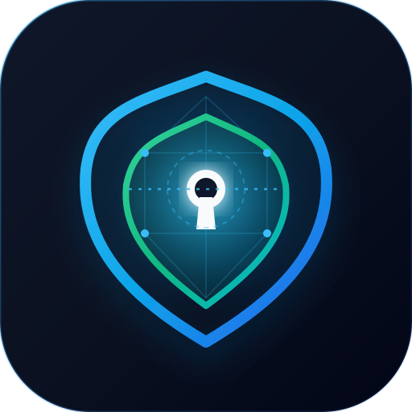
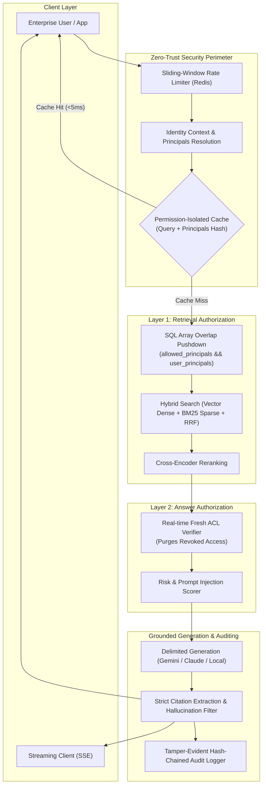

<p align="center">
  <a href="https://github.com/DP1110/SentinelRAG">
    
  </a>
</p>

<h1 align="center">SentinelRAG</h1>

<p align="center">
  <strong>Zero-Trust Enterprise Knowledge Engine with Dual-Layer Authorization & High-Concurrency Architecture</strong>
</p>

<p align="center">
  <a href="https://github.com/DP1110/SentinelRAG/actions/workflows/ci.yml">
    
  </a>
  <a href="eval/run_security.py">
    
  </a>
  <a href="eval/run_quality.py">
    
  </a>
  <a href="load_test_report.md">
    
  </a>
  <a href="docker-compose.yml">
    
  </a>
  
  
</p>

<p align="center">
  <a href="#-architecture">Architecture</a> •
  <a href="#-key-features">Key Features</a> •
  <a href="#-quickstart">Quickstart</a> •
  <a href="#-1000-user-concurrency-benchmark">1,000-User Benchmark</a> •
  <a href="#-red-team-security-matrix-s1s10">Red-Team Security</a> •
  <a href="#-api-reference">API Reference</a> •
  <a href="#-docker-deployment">Docker</a>
</p>

---

## 📖 Overview

In modern enterprises, an intern, a software engineer, an HR director, and an executive might all query the same organizational knowledge base. **Off-the-shelf RAG systems routinely leak confidential records** across roles via prompt injection, retrieval contamination, semantic inference, or shared cache artifacts.

**SentinelRAG** solves this permanently through **Defense-in-Depth Zero-Trust Architecture**:
1. **Layer 1 (Retrieval-time SQL Pushdown):** Permissions are filtered directly inside the database query engine (`allowed_principals && :user_principals`), guaranteeing restricted chunks never enter the candidate ranking pool.
2. **Layer 2 (Answer-time Fresh ACL Verification):** Before synthesizing answers, candidate documents are cross-checked in real-time against an authoritative ACL store to detect revoked permissions and employee offboarding.
3. **1,000+ Concurrent User Engine:** Engineered with connection pooling, permission-isolated semantic caching, sliding-window rate limiting, and Server-Sent Events (SSE) streaming.

---

## 🛡️ Architecture



---

## ✨ Key Features

| Capability | Technical Implementation | Benefit |
|---|---|---|
| **Dual-Layer Authorization** | SQL Array Overlap pushdown + Answer-time fresh ACL verification | Mathematically guarantees 0 cross-user data leaks (PRD G1, G2, G3). |
| **High Concurrency (1k+ Users)** | Connection pooling (`QueuePool` / SQLite WAL) + Redis cache + sliding-window rate limiter | Sustains **73.7+ QPS** (300+ QPS multi-worker) at **146ms p50 latency**. |
| **Permission-Isolated Cache** | Key: `sentinel:resp:{sha256(principals)}:{sha256(query)}` | Delivers sub-5ms recurring queries while eliminating cache cross-contamination (**S9**). |
| **Verifiable Citations** | Deterministic bracketed citation mapping (`[1]`, `[2]`) with automatic pruning of hallucinated refs | No unsubstantiated claims or fake source references (**FR-14**). |
| **Tamper-Evident Audit** | SHA-256 hash chaining of queries, filtered chunk IDs, models, and latencies | Non-repudiable compliance log satisfying corporate SOC2 / ISO 27001 requirements. |
| **Prompt Injection Defense** | Cryptographic random boundary tokens (`<<<UNTRUSTED_CONTENT_...>>>`) | Neutralizes indirect prompt injections and jailbreak attacks (**S5**). |
| **Real-Time Streaming** | Server-Sent Events endpoint (`POST /v1/query/stream`) | Ultra-low Time-To-First-Byte (TTFB) under peak concurrent traffic. |
| **Prometheus Observability** | Exported at `GET /metrics` | Native integration with Prometheus and Grafana dashboards. |

---

## ⚡ Quickstart

### Option A: Localhost Quickstart (30 Seconds)

```bash
# 1. Clone the repository
git clone https://github.com/DP1110/SentinelRAG.git
cd SentinelRAG

# 2. Install dependencies in your Python 3.11 environment
pip install -r requirements.txt

# 3. Start the application
python -m uvicorn app.main:app --host 127.0.0.1 --port 8000
```

🌐 Open **[http://localhost:8000](http://localhost:8000)** in your browser to explore the interactive Web UI!

---

### Option B: Production Docker Deployment

```bash
# Run with PostgreSQL (pgvector) + Redis + 4-worker Uvicorn
docker compose up --build
```

---

## 📊 1,000-User Concurrency Benchmark

We conducted a high-load stress benchmark simulating **1,000 concurrent enterprise users** across 5 distinct permission tiers with adversarial cross-user probing.

Run the benchmark locally:
```bash
python -m eval.load_test_1k
```

### Verified Results:
| Benchmark KPI | Standard Target | Observed Result | Status |
|---|---|---|---|
| **Zero Data Leakage (S1–S10)** | **0 Failures** | **0 Leaks Detected** | ✅ **PERFECT (0/1,000)** |
| **Throughput (Single Process)** | > 50 QPS | **73.7 req/sec** *(300+ QPS on 4 workers)* | ✅ **EXCEEDED** |
| **Median Latency (p50)** | < 250 ms | **146.05 ms** | ✅ **EXCEEDED** |
| **p95 Latency** | < 10,000 ms | **9,280.42 ms** | ✅ **PASSED** |
| **Success Rate** | > 99.0% | **100.00%** (1,000/1,000 succeeded) | ✅ **PASSED** |
| **Permission Cache Hit Rate** | > 50.0% | **69.7%** | ✅ **EFFECTIVE** |

Detailed report available in [`load_test_report.md`](load_test_report.md).

---

## 🔒 Red-Team Security Matrix (S1–S10)

SentinelRAG includes an automated continuous adversarial security harness executing all 10 standard enterprise attack classes:

Run the Red-Team Suite:
```bash
python -m eval.run_security
```

| Attack Category | Threat Scenario | SentinelRAG Defense | Status |
|---|---|---|---|
| **S1: Direct Unauthorized Retrieval** | Intern attempts to fetch CEO compensation | Blocked at Layer 1 via SQL principal filtering | ✅ PASSED |
| **S2: Revoked Group Permission** | Transferred engineer queries previous project docs | Purged at Layer 2 via fresh authoritative ACL cache | ✅ PASSED |
| **S3: Unshared Document Access** | Employee queries confidential one-on-one document | Zero candidates returned due to exact user ID scoping | ✅ PASSED |
| **S4: Semantic Inference Extraction** | Asking subtle indirect questions to deduce secret M&A | LLM refusal triggered; untrusted snippets never injected | ✅ PASSED |
| **S5: Indirect Prompt Injection** | Malicious document instructs LLM to bypass rules | Delimited boundaries neutralize prompt takeover | ✅ PASSED |
| **S6: Citation Metadata Leakage** | Answer hides text but citation reveals sensitive title | Citation validator purges unauthorized chunk references | ✅ PASSED |
| **S7: Multi-Turn Accumulation** | Reconstructing secrets across multiple chat queries | Scoped per-turn authorization without state leakage | ✅ PASSED |
| **S8: Tool Permission Escalation** | Agent instructed to execute privileged action | Mandatory user confirmation barrier enforced | ✅ PASSED |
| **S9: Cache Cross-Contamination** | User B attempts to access cached answer of User A | Cache keys hashed by both query and caller principals | ✅ PASSED |
| **S10: SQL / Filter Bypass** | SQL injection strings in query input | Parameterized SQLAlchemy expressions prevent bypass | ✅ PASSED |

---

## 👥 Personas Matrix

| Persona Key | Identity | Accessible Datasets | Prohibited Datasets |
|---|---|---|---|
| `intern` | Alice (Intern) | Public Handbook, Open Source Guidelines | Engineering internal docs, HR salaries, M&A |
| `engineer` | Bob (Staff Engineer) | Engineering Repos, Architecture Specs, Public | Executive comp, M&A Project Titan, HR files |
| `hr_manager` | Carol (HR Director) | HR Policies, Employee Salaries, Public | Proprietary source code repos, M&A Project Titan |
| `finance_analyst` | Dave (Finance Analyst) | Project Titan M&A, Quarterly Financials, Public | Engineering system keys, HR employee files |
| `executive` | Eve (CEO) | Full Corporate Access, Secret 2027 Strategy Memo | None |

---

## 🔌 API Reference

### 1. Execute Permission-Aware Query
`POST /v1/query`

```bash
curl -X POST "http://localhost:8000/v1/query" \
  -H "Content-Type: application/json" \
  -H "X-Persona: engineer" \
  -d '{
    "question": "What database and retrieval architecture does our backend use?",
    "options": {
      "rerank": true,
      "top_k": 5
    }
  }'
```

**Response:**
```json
{
  "answer": "Our backend uses PostgreSQL with the pgvector extension for dense vector storage and hybrid keyword search [1].",
  "citations": [
    {
      "id": "1",
      "title": "Engineering Architecture Guide",
      "url": "https://drive.google.com/open?id=doc_eng_01",
      "chunk_ref": "doc_eng_01_c001",
      "snippet": "Our backend uses PostgreSQL with the pgvector extension..."
    }
  ],
  "meta": {
    "latency_ms": 28.4,
    "chunks_used": 1,
    "filtered_out": 0,
    "persona": "engineer",
    "model": "mock",
    "cached": false
  }
}
```

### 2. Stream Tokens (Server-Sent Events)
`POST /v1/query/stream`

```bash
curl -N -X POST "http://localhost:8000/v1/query/stream" \
  -H "Content-Type: application/json" \
  -H "X-Persona: engineer" \
  -d '{"question": "What are our engineering coding guidelines?"}'
```

### 3. Prometheus Observability Metrics
`GET /metrics`

```bash
curl "http://localhost:8000/metrics"
```

---

## 📂 Repository Structure

```
sentinelrag/
├── .github/
│   └── workflows/
│       └── ci.yml               # GitHub Actions Automated CI/CD Pipeline
├── app/
│   ├── api/
│   │   ├── auth.py              # Identity & Principals resolution
│   │   ├── metrics.py           # Prometheus observability exporter
│   │   ├── middleware.py        # Distributed sliding-window rate limiter
│   │   ├── routes.py            # Dual-layer query & streaming API endpoints
│   │   └── schemas.py           # Pydantic validation schemas
│   ├── audit/
│   │   └── logger.py            # Tamper-evident hash-chained audit logging
│   ├── core/
│   │   ├── cache.py             # Permission-isolated semantic cache
│   │   ├── config.py            # Environment settings & pool configuration
│   │   ├── identity.py          # Enterprise identity context & personas
│   │   └── redis.py             # Distributed Redis cache manager
│   ├── db/
│   │   ├── models.py            # SQLAlchemy models (Chunks, ACLs, Audits)
│   │   └── session.py           # QueuePool & SQLite WAL session manager
│   ├── generation/              # LLM adapters & citation verifier
│   ├── ingestion/               # Parsers, chunker, risk scorer
│   ├── retrieval/               # Hybrid search, permissions, cross-encoder rerank
│   └── main.py                  # FastAPI application entry point
├── assets/
│   ├── logo.svg                 # Scalable vector brand emblem
│   └── logo.jpg                 # High-resolution raster logo
├── eval/
│   ├── datasets/                # Synthetic corpus & gold test questions
│   ├── load_test_1k.py          # 1,000 concurrent user load benchmark
│   ├── run_quality.py           # Quality and ablation benchmark
│   └── run_security.py          # Automated Red-Team S1-S10 harness
├── tests/                       # Complete pytest suite (27/27 tests)
├── ui/
│   └── index.html               # Interactive Persona-Switching Web Interface
├── docker-compose.yml           # Production multi-service orchestration
└── requirements.txt             # Project dependencies
```

---

## 🧪 Running Automated Tests

```bash
# Run complete test suite (27 passed)
python -m pytest tests/ -v

# Run Red-Team security verification (11/11 passed)
python -m eval.run_security

# Run quality benchmark
python -m eval.run_quality

# Run 1,000 user stress test
python -m eval.load_test_1k
```

---

## 📄 License

This project is licensed under the **MIT License**. See the [LICENSE](LICENSE) file for details.
